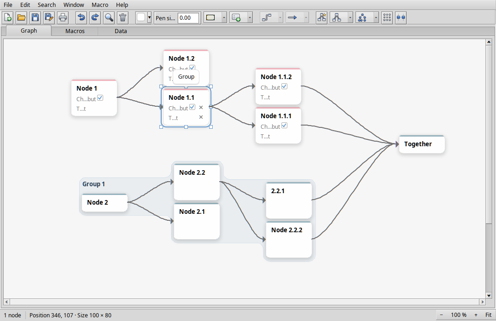
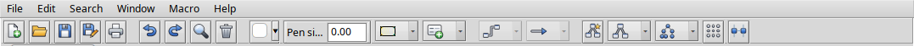
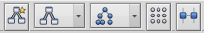
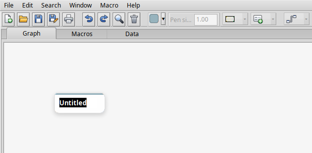
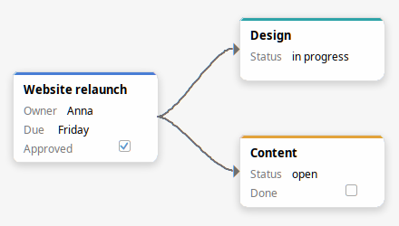
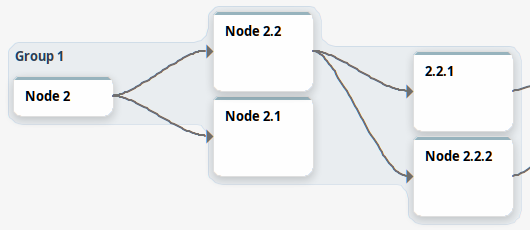
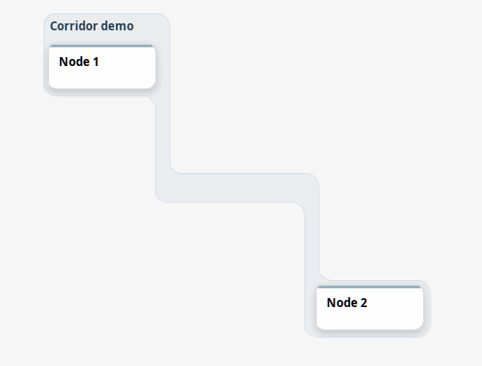
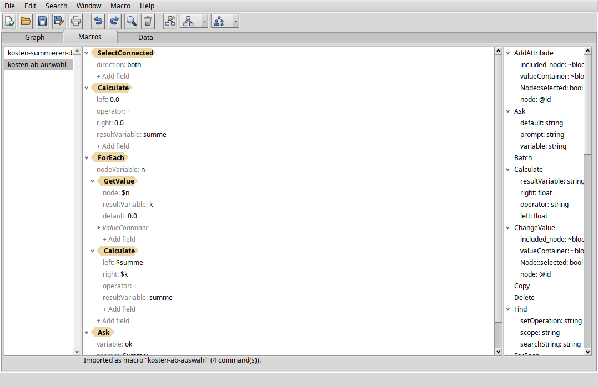

# ProjectConceptor - User Guide

ProjectConceptor is a graph editor for Haiku: nodes, attributes and
connections, groupable, with automatic layout. This document walks
through the main workflows using screenshots of a running instance.

## The toolbar

Left to right: file actions (New, Open, Save, Save As, Print), then
Undo, Redo, Find and Delete. The groups after that act on the selection
and are shown while the **Graph** tab is active:

- **Color** - opens the color picker. For nodes it has four tabs:
  **Fill** (the card's background), **Highlight** (the band along the
  top), **Border** and **Text**; for connections it sets the line
  color. Each tab offers the theme's standard color, a palette, the
  custom colors you used recently, and an alpha slider for see-through
  colors. The color shows live on the selection.
- **Pen size** - the border width of the selected nodes, or the line
  width of the selected connections (arrowheads grow with it).
- **Node shape** - rounded rectangle, rectangle, ellipse, diamond,
  triangle, hexagon, parallelogram, or note. Name and attributes stay
  inside the shape, and connections dock on its outline.
- **Attribute** - adds an attribute to the selected nodes: text,
  yes/no, note, number, choice list, date, color, link, file or image
  (see below).
- **Connection shape** - straight, rounded, or angular.
- **Arrow ends** - arrowhead at the target, at the source, at both
  ends, or none.

The choice fields show the current pick as an icon; the pop-up menu
also carries the name. Undo and macro recording work as for any other
change.

Then the automatic layout:

- **Leftmost icon** - applies the automatic layout.
- **Direction** - which way the graph grows (top-to-bottom,
  left-to-right, etc.).
- **Topology** - the layout algorithm (hierarchical, circular,
  force-directed, ...).

The last two icons toggle the **grid**, which snaps node positions as
you create or drag them, and the **smart alignment guides**, which
show when a dragged node lines up with its neighbours.

The status bar at the bottom shows the selection, its position and
size, and the zoom; **-**, **+** and **Fit** change the zoom, which
keeps the middle of the view in place. The numbers after **Position**
and **Size** can be clicked and typed over: the selected nodes' left
and top edge, width and height. Enter applies a number, Escape keeps the
old one. With several nodes
selected, a field stays empty where they differ, and a typed value sets
it for all of them - e.g. the same width. A card is never smaller than
its content.

## Creating a node

Double-clicking an empty spot in the **Graph** tab creates a new node
and immediately puts its name into edit mode:

Type a name, done. Double-clicking *inside* an existing group instead
adds the new node as a child of that group directly.

Hovering over a node shows its resize handles and connection points; a
selected node keeps its handles on all sides and corners. The mouse
pointer shows what a click would do - edit text, toggle, resize, or
start a connection.

## Attributes

Any node can carry its own attribute rows - added to the selected
nodes via the toolbar's **Attribute** menu. The new row's name opens for
typing right away:

Click a name or a text value to edit it, click a yes/no box to toggle
it. A selected node shows a small cross at the end of each row to
remove it; a right click on a row offers **Delete**, and **Change…**
where a click does something else (see below).

| Kind | Shows | A click |
|---|---|---|
| Text | the text | edits it |
| Yes/No | a check box | toggles it |
| Note | text over several lines | edits it (see *Notes*) |
| Number | the number with its unit, e.g. `1.234,5 €` | edits it: type the number and the unit after it (`25,5 €`, `3 h`); `,` or `.` both work as the decimal point |
| Choice list | the current choice with a small arrow | shows the list; **Edit choices…** at its end edits the list, one choice per line |
| Date | the date in your language's format | opens a calendar; **Today** and **No date** below it |
| Color | a color field and its code | opens the color picker |
| Link | the address | opens it in the browser; a click behind it, or **Change…**, edits it |
| File | the file's name | opens it with its preferred application; a click behind it, or **Change…**, chooses another |
| Image | the picture, as wide as the node | opens it; **Change…** chooses another |

A document keeps the path of a file or image, not the file itself:
moved or renamed, it can't be found any more.

Macros read numbers with **GetValue** like any other number; the unit
stays out of the calculation.

The names form one column, so the values line up. It is as wide as
the longest name; on a selected node, drag the border between names and
values to set the width for that node, and double-click the border to
fit the names again. Names that don't fit are shortened with "…".

### Notes

A **Note** is text over several lines, for descriptions, minutes or
to-dos. It uses the whole width of the node, without a name, and the
node grows with it (up to twelve lines; more is cut with "…"). A new
note opens for typing at once; click it to edit it again. **Enter**
starts a new line, **Esc** or a click outside finishes.

A note shows a little Markdown; the text itself stays plain:

| You write | You see |
|---|---|
| `**bold**`, `*italic*` | **bold**, *italic* |
| `# Heading` | a bold line |
| `- item`, `* item`, `1. item` | a list item; longer items wrap under their text |
| `[text](https://...)`, `https://...` | a link - a click opens it in the browser |
| `\*` | a plain `*` |

## Search and bulk edits

**Search &rarr; Find** looks for a string across every node's name and
attribute values and selects every node that matches (replacing whatever
was selected before) - a quick way to gather up all the nodes that
share something in common instead of clicking them one by one.

Below it, **Or compare an attribute** picks nodes by one attribute:
choose the attribute (or *Any attribute*, or *Node name*), how to
compare - *contains*, =, ≠, <, ≤, >, ≥ - and type the value. Numbers
compare as numbers (`Budget > 1000`), dates in time
(`Due < 2026-12-01`), yes/no as `yes` or `no`, anything else as text
without regard to upper and lower case. The selection follows as you
type; **OK** keeps it.

That selection then doubles as a bulk edit: with several nodes
selected, changing an attribute's value on one of them applies the
same change to every other selected node too, not just the one you
clicked on.

## Connections

Dragging from one of a node's four connection points to another
node creates a connection between them; it can be dropped anywhere on
the target node. The line docks where it meets the node's outline,
also for shaped nodes. Its shape and arrow ends can be
changed afterward via the toolbar icons above, as long as the
connection is selected (works on several at once).

## Grouping

Select several nodes, then click **Group** in the small bar that
appears above the selection. The group draws itself as one connected shape that hugs its children
tightly - even when they're different sizes or don't line up at the
same height:

The shape grows automatically as a child moves or a new one is added,
and shrinks back just as readily when a child is removed. Double-
clicking the group's own area adds a new child node to it directly (see
above).

A freshly created group is drawn as a faint tint behind its children;
the color picker's **Fill** tab gives it a color of its own.

If two children don't overlap vertically at all - one sitting entirely
above the other - the group connects them with a short, fixed-width
corridor instead of stretching a single shape across the gap:

## Automatic layout

The automatic layout icon in the toolbar (see above) rearranges the
whole graph - useful after inserting many nodes by hand, which tend to
overlap. Direction and topology can be set first via the two fields
next to it.

## Macros

The **Macro** menu records a sequence of actions and plays it back
later. The **Macros** tab shows a macro as a tree you can edit -
change values, add and move commands - and builds new macros from a
list of all commands. Macros can repeat steps, run them per selected
node or only when a search finds something, pass values along in
variables and put them into text, and are saved with the document.

See [Macros](macros.md) for the full guide and the command reference.

## Save, load, undo

- **File → Save / Save As** writes the document to a `.pcd` file (or
  as XML text, which keeps everything too).
- **File → Export** writes a copy in a format for other programs. The
  document itself stays in its own file.
  - **Pictures** (PNG, JPEG, WebP, … - whatever image formats Haiku has
    translators for): the graph as the editor draws it, on white,
    without the grid or the selection, at twice its size so it stays
    sharp.
  - **HTML page**: one file anyone can open in a browser, no Haiku
    needed. Drag to move, scroll to zoom, click a node to see all its
    attributes, type into Search to find nodes. Follows the browser's
    light or dark scheme.
  - **SVG image**: the graph as a picture to put into other documents or
    to edit further, e.g. in Inkscape.
  - **Graphviz DOT**: for the Graphviz tools; `neato -n` keeps the
    positions from ProjectConceptor, `dot` lays the graph out anew.
  - **Mermaid flowchart** and **Markdown with Mermaid**: text that
    GitHub, GitLab and many Markdown editors show as a diagram, e.g. in
    a README or an issue.
  - **draw.io diagram**: to edit further in draw.io (diagrams.net), in
    any browser; draw.io in turn exports to Visio, PDF and PNG. Groups
    become containers, attributes the shapes' data. ProjectConceptor
    opens draw.io files too.
  - **GraphML**: for yEd, Gephi, NetworkX, Cytoscape and other graph
    tools; yEd shows places, colors and labels as here. ProjectConceptor
    opens GraphML files too.
  - **FreeMind**: a mind map; the graph becomes a tree from one of its
    nodes.
- **File → Print** prints the whole graph at 100 %, over as many pages
  as it needs, on white paper without the grid or the selection. With
  the *PDF Writer* printer (set it up in the Printers preferences) this
  makes a PDF file. **File → Page setup** chooses the paper.
- **File → Open** loads an existing document, or a file of another
  format: a draw.io diagram, a GraphML graph from yEd, Gephi or
  NetworkX, or a FreeMind mind map. That one stays as it is: the
  first Save asks where to store the document.
- **Edit → Undo / Redo** covers every change - creating nodes, moving
  them, grouping, editing attributes, drawing connections.
- **Edit → Select all** selects the entire graph at once, e.g. to move
  all of it together.
